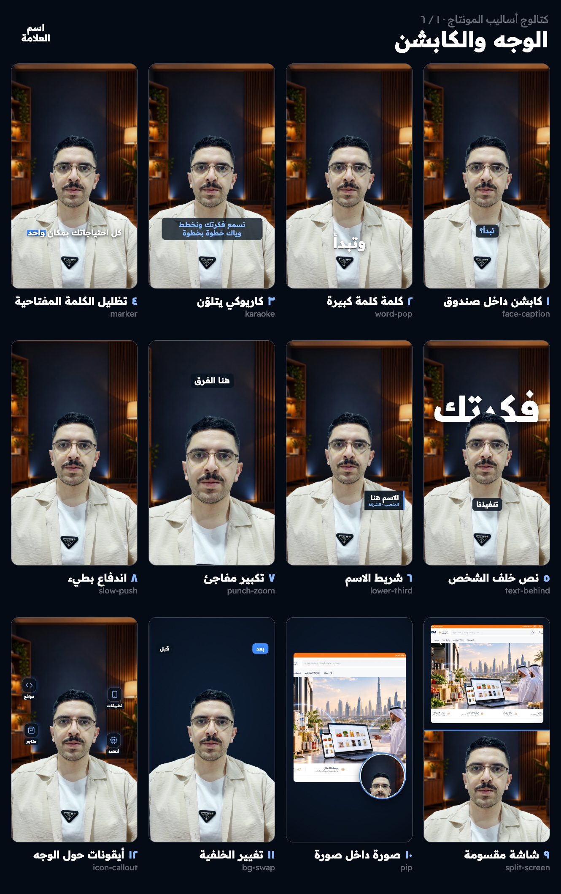

# Montage Studio — استوديو مونتاج الريلز بالكود

سكل لـ [Claude Code](https://claude.com/claude-code) يحوّل فيديو خام إلى ريل أو إعلان عمودي (1080×1920) جاهز للنشر، بالكود عبر [Remotion](https://www.remotion.dev).
يشمل قص السكتات، والنسخ الصوتي العربي، والكابشن، وتغيير الخلفية، والموشن كرافيك، والمؤثرات، والموسيقى، والتصدير، والفحص.

A Claude Code skill that turns a raw talking-head video into a polished vertical reel/ad with Remotion: silence cutting, Arabic word-level transcription, captions, background replacement, motion graphics, SFX/music, export and QA — with a library of **70 editing styles**.



## التنصيب (macOS)

```bash
git clone https://github.com/moamenhani-droid/montage-studio ~/.claude/skills/montage-studio
```

```bash
~/.claude/skills/montage-studio/scripts/install.sh
```

السكربت آمن للتكرار، ويكمل الناقص فقط:
- **الأدوات:** Homebrew، وffmpeg، وwhisper.cpp، وNode، وPython مع numpy.
- **نموذج Whisper:** large-v3-turbo بحجم 1.6 GB، مع استئناف التنزيل.
- **مهارات ريموشن:** المهارات وإضافته.
- **حزم ريموشن:** في مخبأ يُستنسخ لكل مشروع دون مساحة إضافية.

للفحص دون تنصيب:
```bash
~/.claude/skills/montage-studio/scripts/doctor.sh
```

## الاستخدام
في Claude Code، أرسل مسار الفيديو والسكربت وقل «سوّيله مونتاج». السكل يمر بالمراحل التالية، ويطلب اعتمادك بين كل مرحلة والتي بعدها:

1. **الاستلام والأسئلة:** الوجه، والخلفية، والأسلوب، والموسيقى.
2. **مشروع جديد وتحليل:** `scripts/new_project.sh <video> [dir] --prep`. يحوّل HDR، وينظّف الصوت، ويقيس بداية الكلام.
3. **نسخ ومطابقة:** `work/transcribe.py` ثم `work/align.py` على النص المنطوق فعلاً.
4. **قرار القص والمشاهد:** ملف واحد، `work/edit.py`، ثم `work/edit.py` و`work/make_audio.py`.
5. **قص الشخص** (اختياري): `work/matte.sh`، عبر Apple Vision. **تلوين** (اختياري): `work/grade.sh teal-orange`.
6. **معاينة حية:** Remotion Studio، ثم التحريك الكامل والتعديلات.
7. **التصدير:** `reel/scripts/render.sh`. يخرج النسخة الرئيسية، والنسخة بلا كابشن، والقصيرة، والغلاف، بمستوى ‑14 LUFS. ثم الفحص بـ `work/qa.py`.

## الأساليب
**٦٢ أسلوباً مرئياً** في `template/reel/src/styles/`، و**٨ تقنيات قص وصوت**. التفاصيل في [references/styles.md](references/styles.md).

| الفئة | أمثلة |
|---|---|
| الوجه والكابشن | كابشن داخل صندوق، كلمة كلمة، كاريوكي، نص خلف الشخص، شريط الاسم، تكبير مفاجئ، صورة داخل صورة |
| الطباعة الحركية | سطر حركي متزامن، رقم يعدّ، آلة كاتبة، كشف من قناع، شطب واستبدال، نيون |
| الواجهات | محادثة، إشعارات، موقع يُبنى، تطبيق في جوال، مسار مراحل، مقارنة، بناء الشعار |
| الأرقام | أعمدة، خط نمو، دائرة نسبة، أعمدة ومكعبات ثلاثية الأبعاد |
| الرسم اليدوي | سبورة متسلسلة، تعليق يدوي، قصاصات ورق، مخطط هندسي |
| الانتقالات | Whip pan، تكبير عبر عنصر، كاميرا على لوحة واحدة، مسح دائري، وميض |
| اللون | تيل وبرتقالي، دافئ، بارد، أبيض وأسود، سينمائي، لونان |

لوحات الكتالوج: `assets/catalog/`. ولتوليدها: `node reel/scripts/gallery.mjs`.

## المتطلبات والترخيص
- macOS: قص الشخص يعتمد Apple Vision.
- Remotion مجاني للأفراد والفرق حتى ٣ أشخاص، وما فوق ذلك يحتاج [ترخيص شركة](https://www.remotion.dev/license).
- المجلد `examples/almonafithoon-ad/` مثال حقيقي كامل لإعلان أُنتج بهذا النظام.
